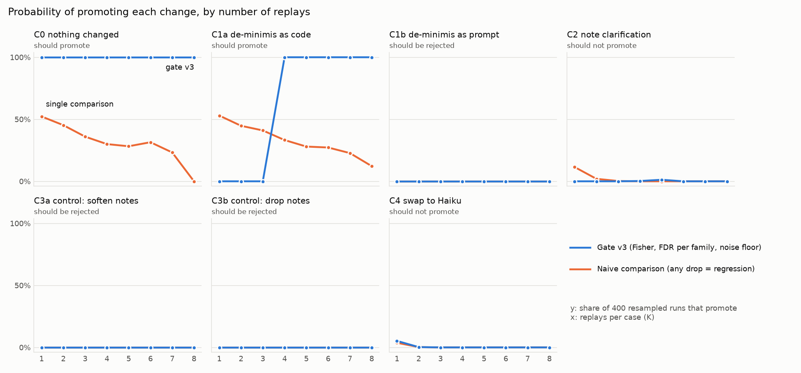

# Margin-Guard

When a supplier raises a price, every open quote built on that material is quietly losing
money. Usually nobody notices until the job is already shipped at the old margin.

Margin Guard reads the supplier's email, works out which open quotes the change hurts and by
how much, decides what to do about each one, drafts the message, and puts it in front of a
person. Agents coordinate the work and a person approves every outcome. An evaluation loop
measures when the system can be trusted, and turns every human correction into a test.

Built in four days as a working prototype on a synthetic rubber-molding shop: 150 open quotes,
24 customers, 12 materials and a supplier inbox full of traps.

## Results

| What was measured | Result |
|---|---|
| Supplier emails read correctly: the 15 the pipeline was built on | **15 / 15** (outcome, material, $/lb, date) |
| Supplier emails read correctly: 10 harder ones nothing was tuned against | **9 / 10**; the miss was sent to a person, no wrong price got through |
| Cents, currency and pack emails, after the cents/currency fix (regression set, written with the fix) | **7 / 7**: 121¢/lb, 88.5 cents, $ with old price in cents, $/cwt, 50 lb bag; CAD and EUR sent to a person |
| Quote decisions on the full shop, vs. an independent copy of the policy | **282 / 282**: 246 settled by rules, 36 judgment calls by Claude, every draft quoting the computed prices |
| Cards that were stale because an earlier-dated supplier change arrived later (the demo inbox is out of date order) | **50** restated and re-decided; live cards are identical across arrival, date, reverse and random orders |
| 30 hand-built judgment calls x 3 runs (Claude Sonnet 5.5) | **87 / 90** right, same answer every run, every draft passes its checks |
| ...of those, calls made with confidence ≥ 0.90 | **93% of calls, 100% right**. All 3 misses came in at ≤ 0.60 |
| Margin leaked on the shop's 88 won jobs (Jan-Oct 2026, synthetic) because costs moved between quote and order | **$6,151** on 56 jobs ($5,568 net of decreases), 29.4% -> 28.9% margin, 1 job pushed below its floor |
| Prompt injection hidden in a customer note (2 cases) | Refused both times, and **flagged the bad instruction** to the account manager |
| Cost per judgment call | **$0.009** (Sonnet 5.5) |

### Sonnet vs Haiku: calibration matters more than accuracy

| | Sonnet 5.5 | Haiku 5.5 |
|---|---|---|
| Right action | 97% | 94% |
| Same answer on every run | 100% | 93% |
| Cost per decision | $0.0088 | $0.0006 |
| Confidence on its misses | **0.55 – 0.60** | **0.90** |

Haiku is 15x cheaper and nearly as accurate, but it is wrong *confidently*. On a $30k quote it
reasoned "at or above the $15,000 threshold, but standard tier, so the rule does not apply" and
reported 0.90. Sonnet's mistakes are unsure, so its confidence can tell a reviewer which cards
to read carefully. In a human-in-the-loop system that is the property that matters, so the
console runs on Sonnet.

### What the loop learned from real reviews

In the console, a reviewer absorbed a $36 increase on a $1,124 quote instead of calling the
customer as Claude proposed. That isn't a model error. The policy never lets Claude absorb below
the floor, so `eval_approvals` reports it as a **policy signal**: if it repeats, the shop
probably wants a de-minimis rule ("absorb anything under $X at risk"). Overrides the model *can*
learn from (for example "call" changed to "email") are written out as new regression cases
automatically.

## When is a change safe to promote?

A correction suggests a change: a new rule, a policy edit, a cheaper model. But Claude doesn't
answer the same way every time, so one before/after run can't tell a regression from noise. The
promotion gate replays each candidate change against 62 cases (the 30 scenarios + a frozen snapshot of the shop's 32
judgment calls), 8 times each, and decides **promote / hold / reject** per case, with a noise
floor measured by replaying the unchanged system against itself.

| Finding | |
|---|---|
| With nothing changed, one run vs another flags a "regression" | **48%** of the time, all from 2 of 62 cases that wobble on their own |
| The gate (per-case Fisher test, false-discovery control, noise floor) on the same no-op | **0%** false alarms at every replay count |
| Replays per case before the correct change is promoted | **4** (it fixes 7 targets, 0 regressions) |
| The same de-minimis rule written as prompt text instead of code | fixes the same 7, **breaks 7 others**; aggregate accuracy calls it a wash (CI crosses 0) |
| Deliberately bad "tidy-up" policy edits (controls) | never promoted at any replay count; rejected at 8 |
| Sonnet → Haiku swap | **hold**: 6 cases got worse, none conclusively yet |



Every proposed change goes into a **[correction ledger](evals/results/promotion/ledger.md)** that
keeps two questions apart: is it *safe* (the gate) and is it *wanted* (what reviewers did on the
cards it would change). The de-minimis rule passes the gate but is **held**: across 55 later
reviews nobody absorbed a small increase, so its only support is the one override that suggested
it. Reviewer corrections are noisy too: the same customer note drew opposite overrides.

Full write-up, method and limits: **[promotion report](evals/results/promotion/promotion_report.md)**.
The replays (the 7 `replays_C*.json` files) and the 55 reviews are committed, so everything
regenerates with **no API key and no cost**:

```bash
pip install -r requirements-dev.txt      # adds matplotlib for the charts
python -m evals.promotion.report         # gate verdicts, replays-needed curve, charts (~1 min)
python -m evals.promotion.ledger         # correction ledger (append-only, versioned)
python -m pytest                         # offline tests, including the gate and the ledger
```

To re-run the replays yourself (needs `ANTHROPIC_API_KEY`): `python -m evals.promotion.replay --batch --dry-run`
prices it first. Deleting the cached files and running `--batch` redoes all 7 candidates at K = 8
(baseline at 16) for about $13 through the Message Batches API.

## How it works

```
supplier email ──► extract ─────────► normalize ──────────► event log
                   Claude: reports    code: match catalog,  SQLite, append-only,
                   only what the      convert units, % →    idempotent (a forwarded
                   email says         $/lb, sanity checks   copy is a no-op)
                                             │
                          anything doubtful ─┴─► "needs a look" (a person answers)
                                             │
                                             ▼
                   coordinator (LangGraph, one run per price change)
                     impact ──────────► decide ─────────────────► approval queue
                     code: which open   rules settle ~85%;        one live card per quote;
                     quotes, margin     Claude makes the          a newer change supersedes
                     before → after,    judgment calls and        an older card when its
                     $ at risk, prices  writes the draft          numbers already include it
                     that restore
                     margin
```

**Design decisions**

- **The LLM reads; code does every number.** Claude extracts what an email says and makes
  judgment calls. Unit conversion, catalog matching, margin maths and revised prices are all
  deterministic, so every figure on a card can be traced to a row.
- **Rules first.** Expired-before-the-change, price locks and above-floor increases never reach
  the model. It is only asked what the rules can't answer.
- **Refuse to guess.** An ambiguous material ("Black 70" from a distributor selling two),
  a move over 30% (usually a unit slip), a missing date or low extraction confidence goes to a
  person as a one-click question.
- **One costing supplier per material.** A shop can buy EPDM 70 from two suppliers, but quotes
  are costed at one price. Every supplier's prices are recorded; only the costing supplier's
  move margins. A distributor's pass-through increase is shown as "alternate supplier, on file"
  instead of repricing every EPDM 70 quote. A % change applies to the sender's own last price.
  Exposure is replacement-cost exposure; stock already on hand isn't modelled.
- **Arrival order doesn't matter.** Supplier emails don't arrive in date order: the demo inbox
  itself has a Nov 15 nitrile change arriving before a Nov 1 carbon-black one. When an
  earlier-dated change lands, every pending card dated after it is recomputed with it, re-decided,
  and replaces the stale card, which records why. Tested by processing the shop's inbox in
  arrival order, date order, reverse date order and random orders: the live cards are identical.
- **Costs stack.** A quote hit by EPDM +9.5% and carbon black +8.3% gets one card priced on both,
  and the card lists every change behind its numbers.
- **A person approves everything.** Approving a revised quote writes the new prices and queues
  the email. Approving "call first" creates a call task with the buyer's number. Every decision
  can be undone.

### The decision policy

Plain English in [data/pricing_policy.md](data/pricing_policy.md), graded against an independent
implementation in [evals/reference_policy.py](evals/reference_policy.py):

| Situation | Action | Decided by |
|---|---|---|
| Quote expires before the change takes effect | honor | rule |
| Customer's price lock covers the effective date | honor (loss logged) | rule |
| Margin still at or above the quote's floor | absorb | rule |
| Below floor, ≥ $15k or key account | call the customer first | Claude |
| Below floor, otherwise | send a revised quote | Claude |
| A contract note says how revisions must be communicated | follow the note | Claude |

## The console

Built for an estimator, not an engineer.

- **Needs your decision:** Claude's judgment calls sorted by dollars at risk, plus supplier
  emails the system wouldn't guess on. Each card says the margin move in words ("0.7 pts below
  the 27.7% floor"), who to call or email, every cost change behind the numbers, the line-by-line
  prices and an editable draft. It also says whether Claude's confidence clears the eval's bar.
  This is a report only: nothing is approved automatically.
- **Settled by rules:** honor/absorb decisions grouped by price change, confirmed in bulk.
- **Done:** what each person decided next to what was proposed, the outbox, and undo.
- **Data:** quotes, customers and materials, so any number on a card can be checked.
- **Supplier inbox:** each email's current status and what it led to ("17 quotes checked ·
  5 need you"), linked to its cards. "Send test email" drops in a new one, and the activity feed
  streams the agents working on it live.

## Margin leakage: what cost moves already cost you

The console protects open quotes. The leakage report answers the owner's question first:
how much margin did won jobs lose because costs moved after we quoted?

```bash
python -m margin_guard.leakage              # report on the demo shop
```

For each won quote it compares the material cost the price was built on with the cost on the
day the customer ordered, at the costing supplier's price, and reports dollars leaked (and gained
on decreases), the margin as quoted vs as ordered, jobs pushed below their floor, and the
breakdown by material, customer and month. Every leaked dollar comes from a change that took
effect inside the quote's window, the window in which a revised quote could still have recovered
it. Same replacement-cost assumption as everywhere else, stated in the report; a job whose
materials have no price history back to its quote date is listed and left out rather than costed
at today's price. Also served at `/api/leakage`. Pure code, no LLM.

## Bring your own data

A shop is nine CSV files (suppliers, materials, which supplier each material is costed at, price
history, parts, BOMs, customers, quotes, quote lines). [`data/shop_csv/`](data/shop_csv/) is the
demo shop exported in that format, so it doubles as the template.

```bash
python -m margin_guard.importer check data/shop_csv            # validate only
python -m margin_guard.importer import my_shop/ --db mine.db   # validate, then load a new database
python -m margin_guard.importer export out/                    # any database back to CSV
python -m margin_guard.leakage --db mine.db                    # the leakage report on your data
```

The import is all-or-nothing: every row is checked (dates, ranges, references between files,
duplicates, exactly one costing supplier per material, a won quote needs an order date) and if
anything is wrong nothing is written and each problem is listed by file, row and column. A blank
`material_cost_basis` is computed from the BOM and price history at the quote date. Export then
import reproduces the demo shop exactly.

## Evaluation

| Eval | Command | What it checks |
|---|---|---|
| Extraction | `python -m evals.eval_extraction [--set holdout]` | outcome, material, $/lb within 0.5%, date |
| Decisions on the shop | `python -m evals.eval_decisions` | every quote decision vs. the reference policy, and that drafts quote the computed prices |
| Scenario suite | `python -m evals.eval_scenarios` | 30 edge cases x 3 runs x 2 models: accuracy, consistency, draft checks, cost, calibration, the confidence bar |
| Reviews | `python -m evals.eval_approvals` | reviewer agreement by confidence; disagreements become regression cases or policy signals |
| Promotion gate | `python -m evals.promotion.replay --batch` | replays candidate changes K times per case (Message Batches API, cached prompt); `--dry-run` prices it first |
| Gate report | `python -m evals.promotion.report` | per-case verdicts, noise floor, replays-needed curve, cost; no API calls |
| Correction ledger | `python -m evals.promotion.ledger` | each proposed change: safe (gate) vs wanted (reviews), versioned |

The scenario groups are the size threshold ($14,999 / $15,000 / $15,001), tier, notes that
override the rule (including one in Spanish), decoy notes that must not ("call ahead before
deliveries"), conditional notes, prompt injection, stacked changes and price holds that just
ended. All evals cache their model calls, and `--replay` rescores for free.

The offline test suite (`python -m pytest`) makes no API calls. It covers unit conversion,
catalog matching, the event log, impact maths, superseding, every reviewer action including
undo, the API, and the eval machinery itself.

## Known limitations

- **Cents were added after the holdout was scored.** On "118 cents per pound" (H07) Claude reported
  118 per lb and noted the problem; the 30% guardrail sent it to a person. The extraction schema
  now has `price_in_cents` and `currency` fields (a non-USD price goes to a person). The 9 / 10
  holdout score above is the pre-fix, blind result and is kept as is; the fix is measured on a
  separate 7-email regression set (`--set fresh`: cent signs, fractional cents, CAD, EUR, packs),
  which was written alongside the fix and so is not a blind holdout.
- **Money is exact.** All money maths is Decimal with half-up rounding (`margin_guard/money.py`);
  values are rounded to their precision before they're stored, so the REAL columns hold them
  exactly. Amounts are USD only; there is no FX conversion.
- **Late-arriving changes on decided cards.** Pending cards are restated when an earlier-dated
  change lands (see design decisions). A card a person has already *approved* is left alone; the
  new change's card names it and says to check that decision, but nothing re-opens it
  automatically.
- **The promotion gate's shop cases predate restatement.** `data/replay_cases_shop.json` is a
  frozen snapshot of the shop's judgment calls taken before restatement existed, so the gate
  results stay comparable with the committed replays. Rebuilding it would change the case set.
- **A debatable policy edge.** On "key account + prefers email for routine changes, call over
  $10k" at $8k, Sonnet chose a call three times out of three, at 0.55 – 0.60 confidence.
  The written policy says the note wins. The console marks these cards as below the bar.
- **Synthetic history.** The year of price history and the won jobs' order dates behind the
  leakage report are generated (all changes dated on or before Jul 1, so the open quotes and
  every decision on them are unchanged). The report's method is the point; its dollar figure is
  only as real as the data.
- **Synthetic data.** The shop, quotes and emails are generated, and the confidence bar comes
  from 90 runs. Real quotes and real reviews would re-set it, which is what `eval_approvals`
  is for.

## Run it

Needs Python 3.11+ and Node 20.19+ (tested on Python 3.11 and Node 22).

```bash
python -m venv .venv
source .venv/bin/activate              # Windows: .venv\Scripts\activate
pip install -r requirements.txt        # requirements-dev.txt adds pytest + matplotlib (tests, gate report)

# Build the demo shop and run the agents on its inbox.
# --replay reuses the Claude calls cached in evals/results/, so this needs no API key.
python -m margin_guard.seed --reset
python -m margin_guard.ingest --replay evals/results/extractions.json
python -m margin_guard.coordinator --replay evals/results/decisions.json

# Console
uvicorn margin_guard.api:app --port 8000
# in a second terminal:
cd frontend && npm install && npm run dev   # http://localhost:5174
```

Everything above works without an API key. To run Claude live ("Send test email" in the
console, or the commands without `--replay`), copy `.env.example` to `.env` and add an
`ANTHROPIC_API_KEY`. The evals also take `--replay` to rescore cached results for free.
Without a key, "Send test email" and answering a "needs a look" question fail gracefully: the
email shows "could not read" and any judgment call becomes a "Needs your call" card for a person.

Stack: Python 3.11, LangGraph, FastAPI + SSE, SQLite (WAL), React 19 + Vite + Tailwind, and
Claude Sonnet 5.5 through the Anthropic SDK with structured outputs.
