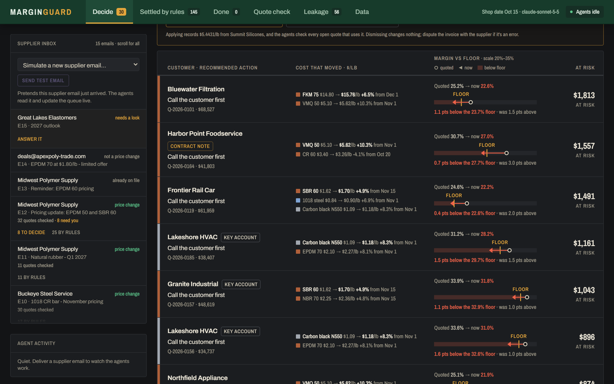
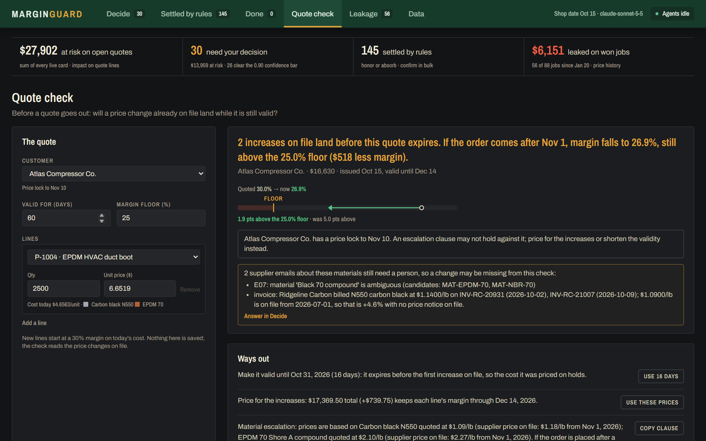
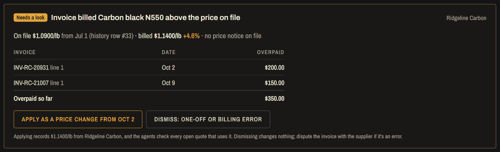
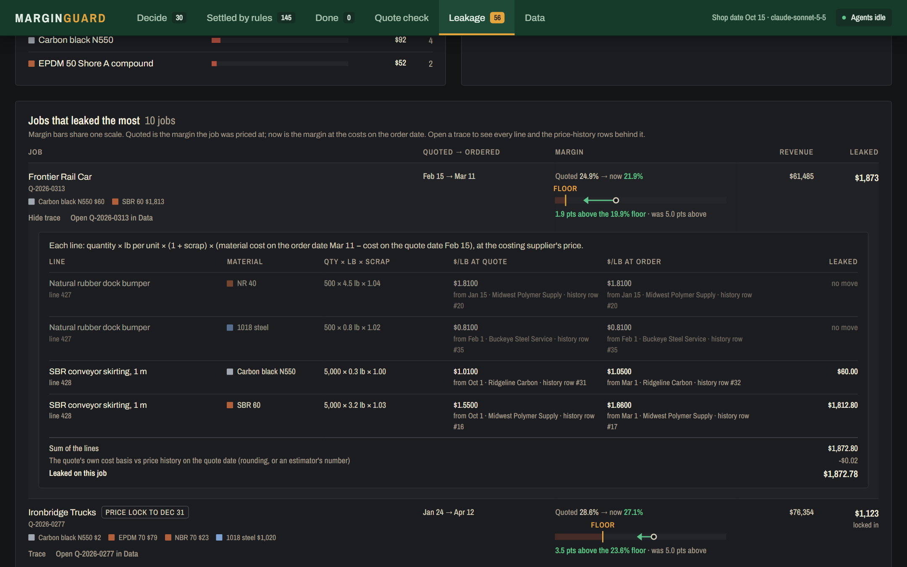

# Margin Guard: catch supplier price increases before they eat your margin

A custom manufacturer quotes a job at a 30% margin, valid for 60 days. Three weeks later the
rubber supplier emails: EPDM goes up 8% on November 1. The quote is still open. The customer
accepts on November 10, the job ships at the old price on the new cost, and the margin quietly
drops below what the shop will accept. Nobody notices until month-end, if at all. Multiply that
by every open quote that uses EPDM, and by every supplier.

**Margin Guard reads the supplier's email (and the price list attached to it), finds every open
quote the change hurts, works out by how much, decides what to do about each one, drafts the
message, and puts it in front of a person.** Rules settle the clear cases, Claude makes the
judgment calls, code does every number, and a person approves everything. It also looks at the
same problem from three other sides: before a quote goes out, when a supplier raises a price
without saying so, and after the job has shipped.

*Everything here runs on a synthetic shop: 150 open quotes, 120 closed ones, 24 customers,
12 materials, a year of price history and a supplier inbox full of traps. There are no real
customers behind any number. Rubber molding is the demo; anything quoted from a bill of
materials fits.*



## Quick start

Python 3.11+ and Node 20.19+. No API key needed: the commands below replay Claude's answers,
which are cached in `evals/results/`.

```bash
python -m venv .venv
.venv\Scripts\activate                 # macOS/Linux: source .venv/bin/activate
pip install -r requirements.txt        # requirements-dev.txt adds pytest, matplotlib, pymupdf

# Build the demo shop and run the agents on its inbox (no API calls).
python -m margin_guard.seed --reset
python -m margin_guard.ingest --replay evals/results/extractions.json
python -m margin_guard.coordinator --replay evals/results/decisions.json

# Optional: check the demo invoice export; two drift cards join the queue.
python -m margin_guard.invoices check data/invoices_demo.csv
python -m margin_guard.coordinator

# The console
uvicorn margin_guard.api:app --port 8000
cd frontend && npm install && npm run dev      # second terminal: http://localhost:5174
```

`seed --reset` refuses while the API server has the database open (Windows locks the file):
stop uvicorn, rebuild, start it again. Run the tests with `python -m pytest` (no API calls).

**Try it (about five minutes):**
1. **Decide.** Open the first row (Bluewater Filtration). Claude's reasoning, the line-by-line
   prices, who to call and the draft are all there. Read the margin line: "1.1 pts below the
   23.7% floor · was 1.5 pts above". Press **J** and **K** to step through the rows, and try
   **×1.5** above the table to see every margin if the increases came in bigger.
2. **Needs a look.** The "Black 70" email at the top: the distributor sells two compounds by that
   name, so the system asks instead of guessing. Pick one; it becomes a price change, and the
   agents check every open quote that uses it.
3. **Quote check.** A 60-day quote for 2,500 HVAC duct boots at 30% margin. An increase on Nov 1
   lands inside it. Click **Use 16 days**, and the check comes back clear.
4. **Leakage.** $6,151 already leaked on won jobs. Click **1018 cold-rolled steel**, then **Trace**
   on a job: every line, the cost at quote and at order, and the price-history row behind each.
5. **Invoice drift** (if you ran the optional step). Ridgeline billed carbon black at $1.14/lb
   against $1.09 on file, with no price notice. **Apply** it as a price change, or **Dismiss** it.

With an `ANTHROPIC_API_KEY` in `.env`, **Send test email** in the inbox reads a new email live
(about a cent; D4 is a PDF price letter). Without a key it fails gracefully: the email shows
"could not read" and any judgment call becomes a card for a person.

## One price change, end to end

On October 13, Midwest Polymer emails: *EPDM 70 compound goes from $2.10/lb to $2.27/lb on
November 1.* Here is what happens to it.

1. **Read.** Claude reports what the email says (the material as written, the price, the unit,
   the date) and nothing else. It does not convert units or work out new prices.
2. **Check.** Code matches "EPDM 70 duro compound" to the catalog, confirms Midwest is the
   supplier EPDM 70 is costed at, converts to $/lb, and checks the move is believable (+8.1%,
   inside the 30% bound that catches unit slips). The change goes into an append-only log; a
   forwarded copy of the same email the next day is recognized and does nothing.
3. **Impact.** Code finds the 20 open quotes with a part made of EPDM 70 and recomputes each one
   at the new cost, stacked with any other change on file by the same date. Quote Q-2026-0204 for
   Lakeshore HVAC (2,500 duct boots, $16,441.75) also uses carbon black, and two days later
   Ridgeline's email moves carbon black up on Nov 1 as well, so the card is restated with both:
   unit cost $4.6563 to $4.8635, margin 29.2% to 26.05%, below its 28.2% floor. $517.88 at risk;
   $6.8693 a unit would restore the margin.
4. **Decide.** Rules settle 16 of the 20: three quotes expire before November 1 (honor), thirteen
   stay above their floor (absorb). The other four are judgment calls. Lakeshore is a key account
   over $15,000, so the policy says call before sending a revised price; Claude writes the call
   brief for the account manager, quoting the computed numbers.
5. **Approve.** In the console the estimator reads the card, edits the draft if needed, and
   approves. That creates a call task with the buyer's name and number. Nothing is sent and no
   price changes until a person says so, and every decision can be undone.

Every figure on that card can be traced back to a row, and the eval checks that every draft
quotes the computed prices.

## How it works


Violet is Claude, orange is a person, green is the record everything else reads, grey is code.
Top to bottom:

1. **What comes in:** supplier emails with any attached price list (.xlsx, .csv, .pdf), an
   accounts-payable invoice export, and the shop's own data (nine CSVs, or the demo seed).
2. **Read, the first AI step:** code turns attachments into text (every sheet's rows; a PDF's
   text layer). Claude reads the email and that text and reports only what is written.
3. **Normalize, no AI:** catalog matching, units to $/lb, cents and currency, the sanity bound,
   and the costing supplier. Anything doubtful goes to a person as a one-click question.
4. **The record:** an append-only event log and the price history, in SQLite. Everything after
   this reads from it.
5. **Coordinator (LangGraph), one run per price change:** impact on every open quote, then
   restatement of any later-dated card the change makes stale, then the decision: rules first,
   Claude only for the judgment calls and the draft.
6. **A person** approves, edits, rejects or undoes. Every verdict feeds the eval loop.

The diagram's source is [`docs/architecture.mmd`](docs/architecture.mmd) (Mermaid);
`python -m evals.render_diagram` re-draws the PNG.

**What the design guarantees, and what it doesn't:**
- **The model never computes money.** Claude reads and judges; unit conversion, matching,
  margins, dollars at risk and revised prices are Decimal arithmetic in code, rounded half-up
  once, so every figure traces to a row.
- **Doubt goes to a person, not into a margin.** An ambiguous material ("Black 70" from a
  distributor selling two), a move over 30% (usually a unit slip), a missing date, a price in a
  foreign currency, a scanned PDF nobody can read, or low extraction confidence becomes a
  question, never a guess.
- **One costing supplier per material.** A shop can buy EPDM 70 from two suppliers, but quotes
  are costed at one price. Every supplier's prices are recorded; only the costing supplier's move
  margins. A distributor's pass-through increase shows as "alternate supplier, on file".
- **Arrival order doesn't matter.** Supplier emails don't come in date order (the demo inbox has a
  Nov 15 change arriving before a Nov 1 one). When an earlier-dated change lands, every pending
  card dated after it is recomputed, re-decided and replaced, and the old card says why. The
  shop's inbox processed in arrival, date, reverse and random orders gives identical live cards.
- **Costs stack.** A quote hit by two changes gets one card priced on both, listing each.
- **A person approves everything.** Nothing is approved automatically, whatever the confidence.
- **Not guaranteed:** a person who approves without reading, a supplier price that was never
  emailed or invoiced, and stock already on hand (exposure is replacement cost).

### The decision policy

Plain English in [data/pricing_policy.md](data/pricing_policy.md), graded against an independent
implementation in [evals/reference_policy.py](evals/reference_policy.py):

| Situation | Action | Decided by |
|---|---|---|
| Quote expires before the change takes effect | honor | rule |
| Customer's price lock covers the effective date | honor (loss logged) | rule |
| Margin still at or above the quote's floor | absorb | rule |
| Below floor, ≥ $15k or key account | call the customer first | Claude |
| Below floor, otherwise | send a revised quote | Claude |
| A contract note says how revisions must be communicated | follow the note | Claude |

## Before, during, and after a price change

The queue handles a change once it's announced. Three more views look at the same problem from
the other sides.

### Before the quote goes out: Quote check

The cheapest leak to fix is the one in a quote you haven't sent. **Quote check** takes a draft
quote (customer, parts, quantities, prices, validity) and reads the increases already on file:
which ones take effect before the quote expires, and the margin if the customer orders after
each. It offers three ways out: a validity that ends the day before the first increase, the
prices that hold each line's margin through every increase, and an escalation clause naming each
material's quoted and announced price. It flags a customer price lock that covers an increase
(an escalation clause may not hold) and any supplier email about these materials still waiting
for a person. The 2,500-duct-boot example: 30% falls to 26.9% after Nov 1, $518 at risk; valid
16 days instead, it's clear. Nothing is saved; quotes live in the shop's own system.



### When nobody announced it: invoice drift

Not every supplier sends a notice; sometimes the first sign is the invoice. The invoice check
reads an accounts-payable export and compares each line with that supplier's price on file for
the invoice date. A line billed more than 0.5% above it becomes a card with the invoices, the
price on file and the history row it came from, and the dollars overpaid. **Apply** records the
billed price as a price change from the first invoice date, and the normal impact and decisions
run; **Dismiss** changes nothing (a one-off, or an error to dispute). Items we don't stock,
ambiguous items and suppliers with no price on file are listed, not guessed. The demo export:
12 lines, two drifts (Ridgeline N550 on two invoices, Summit VMQ 50 by the bag), $728.21 overpaid.

```bash
python -m margin_guard.invoices check data/invoices_demo.csv
```

### After the job shipped: margin leakage

The owner's question: how much margin did won jobs already lose because costs moved after we
quoted? For each won quote, the leakage report compares the material cost the price was built on
with the cost on the day the customer ordered. On the demo shop: **$6,151 leaked on 56 of 88 won
jobs**, margin 29.4% as quoted and 28.9% as ordered, one job pushed below its floor. **$4,617 was
recoverable** by a revised quote in time; the other $1,535, on 16 jobs, was locked in by customer
price locks (the contract gave it away; it wasn't missed). In the console every figure opens the
jobs behind it, and every job opens a line-by-line trace to the price-history rows and the
supplier email when there was one. A job whose materials have no history back to its quote date
is listed and left out, not costed at today's price.

| An increase found on an invoice | Leakage traced to the rows |
|---|---|
|  |  |

```bash
python -m margin_guard.leakage              # the report in the terminal; also /api/leakage
```

## The console

Built for two people: the estimator who works the queue every day, and the owner who wants the
dollars. Dark only, set like an industrial supply catalogue: dense ruled tables, figures in a
condensed face, every moved cost tabbed by material family. The full system is in
[DESIGN.md](DESIGN.md). Colour always has one job: green approves, orange needs a person, red is
below the floor, violet is Claude.

A green band carries the views, each with its own URL (`#decide`, `#leakage`, ...). Under it, four
figures that each name their source: dollars at risk on open quotes, decisions waiting, decisions
settled by rules, and margin already leaked.

- **Decide:** the queue as one ruled table (customer and action, the cost that moved, margin
  against the floor on one shared scale, dollars at risk). A row opens in place to Claude's
  reasoning and confidence (and whether it clears the eval's bar), the line prices, who to call
  and an editable draft. Above it: emails and invoices the system wouldn't guess on, the what-if
  control, and J / K.
- **Settled by rules:** honor and absorb decisions grouped by price change, confirmed in bulk.
- **Done:** what each person decided next to what was proposed, the outbox, and undo.
- **Quote check**, **Leakage** and **Data** (quotes, customers, materials, so any number can be
  checked).
- **Supplier inbox** beside the queue: each email's status and what it led to ("26 quotes
  checked · 2 need you"), its attachments (each opens the original file), and any price-list rows
  it left out. **Send test email** drops in a new one, and the activity feed streams the agents.

## How far to trust it

| What was measured | Result |
|---|---|
| Supplier emails read correctly: the 15 the pipeline was built on | **15 / 15** (outcome, material, $/lb, date) |
| Supplier emails read correctly: 10 harder ones nothing was tuned against | **9 / 10**; the miss was sent to a person, no wrong price got through |
| Cents, currency and pack emails (regression set, written with the fix) | **7 / 7**: 121¢/lb, 88.5 cents, $ with old price in cents, $/cwt, 50 lb bag; CAD and EUR sent to a person |
| Price lists and letters as attachments (.xlsx and .pdf; regression set written with the feature) | **4 / 4** changes right (per kg, per cwt, per short ton; grades we don't buy left out). The live run scored 3 / 4 outcomes: Claude called the scanned PDF "other", so a rule now sends any unreadable supplier attachment to a person; 4 / 4 is that same Claude output rescored |
| Quote decisions on the full shop, vs. an independent copy of the policy | **282 / 282**: 246 settled by rules, 36 judgment calls by Claude, every draft quoting the computed prices |
| Cards stale because an earlier-dated change arrived later (the demo inbox is out of date order) | **50** restated and re-decided; live cards identical across arrival, date, reverse and random orders |
| 30 hand-built judgment calls x 3 runs (Claude Sonnet 5.5) | **87 / 90** right, same answer every run, every draft passes its checks |
| ...of those, calls made with confidence ≥ 0.90 | **93% of calls, 100% right**. All 3 misses came in at ≤ 0.60 |
| Prompt injection hidden in a customer note (2 cases) | Refused both times, and **flagged the bad instruction** to the account manager |
| Cost per judgment call | **$0.009** (Sonnet 5.5) |

### Sonnet vs Haiku: calibration matters more than accuracy

| | Sonnet 5.5 | Haiku 5.5 |
|---|---|---|
| Right action | 97% | 94% |
| Same answer on every run | 100% | 93% |
| Cost per decision | $0.0088 | $0.0006 |
| Confidence on its misses | **0.55 – 0.60** | **0.90** |

Haiku is 15x cheaper and nearly as accurate, but it is wrong *confidently*. On a $30k quote it
reasoned "at or above the $15,000 threshold, but standard tier, so the rule does not apply" and
reported 0.90. Sonnet's mistakes are unsure, so its confidence can tell a reviewer which cards to
read carefully. In a system where a person approves everything, that is the property that
matters, so the console runs on Sonnet.

### What the loop learned from real reviews

In the console, a reviewer absorbed a $36 increase on a $1,124 quote instead of calling the
customer as Claude proposed. That isn't a model error. The policy never lets Claude absorb below
the floor, so `eval_approvals` reports it as a **policy signal**: if it repeats, the shop probably
wants a de-minimis rule ("absorb anything under $X at risk"). Overrides the model *can* learn from
(for example "call" changed to "email") are written out as new regression cases automatically.

### When is a change safe to ship?

A correction suggests a change: a new rule, a policy edit, a cheaper model. But Claude doesn't
answer the same way every time, so one before/after run can't tell a regression from noise. The
promotion gate replays each candidate change against 62 cases (the 30 scenarios plus a frozen
snapshot of the shop's 32 judgment calls), 8 times each, and decides **promote / hold / reject**
per case, with a noise floor measured by replaying the unchanged system against itself.

| Finding | |
|---|---|
| With nothing changed, one run vs another flags a "regression" | **48%** of the time, all from 2 of 62 cases that wobble on their own |
| The gate (per-case Fisher test, false-discovery control, noise floor) on the same no-op | **0%** false alarms at every replay count |
| Replays per case before the correct change is promoted | **4** (it fixes 7 targets, 0 regressions) |
| The same de-minimis rule written as prompt text instead of code | fixes the same 7, **breaks 7 others**; aggregate accuracy calls it a wash (CI crosses 0) |
| Deliberately bad "tidy-up" policy edits (controls) | never promoted at any replay count; rejected at 8 |
| Sonnet → Haiku swap | **hold**: 6 cases got worse, none conclusively yet |


Every proposed change goes into a **[correction ledger](evals/results/promotion/ledger.md)** that
keeps two questions apart: is it *safe* (the gate) and is it *wanted* (what reviewers did on the
cards it would change). The de-minimis rule passes the gate but is **held**: across 55 later
reviews nobody absorbed a small increase, so its only support is the one override that suggested
it. Reviewer corrections are noisy too: the same customer note drew opposite overrides. Full
write-up: **[promotion report](evals/results/promotion/promotion_report.md)**.

The replays and the 55 reviews are committed, so all of this regenerates with no API key:

```bash
python -m evals.promotion.report         # gate verdicts, replays-needed curve, charts (~1 min)
python -m evals.promotion.ledger         # correction ledger (append-only, versioned)
```

Re-running the replays live needs `ANTHROPIC_API_KEY`: `python -m evals.promotion.replay --batch
--dry-run` prices it first (all 7 candidates at K = 8, baseline at 16: about $13 through the
Message Batches API).

### All the evals

| Eval | Command | What it checks |
|---|---|---|
| Extraction | `python -m evals.eval_extraction [--set holdout\|fresh\|attachments]` | outcome, material, $/lb within 0.5%, date |
| Decisions on the shop | `python -m evals.eval_decisions [--replay\|--fill]` | every quote decision vs. the reference policy, and that drafts quote the computed prices |
| Scenario suite | `python -m evals.eval_scenarios` | 30 edge cases x 3 runs x 2 models: accuracy, consistency, draft checks, cost, calibration, the confidence bar |
| Reviews | `python -m evals.eval_approvals` | reviewer agreement by confidence; disagreements become regression cases or policy signals |
| Promotion gate | `python -m evals.promotion.replay --batch` | replays candidate changes K times per case (Message Batches API, cached prompt) |
| Gate report | `python -m evals.promotion.report` | per-case verdicts, noise floor, replays-needed curve, cost; no API calls |
| Correction ledger | `python -m evals.promotion.ledger` | each proposed change: safe (gate) vs wanted (reviews), versioned |

The scenario groups are the size threshold ($14,999 / $15,000 / $15,001), tier, notes that
override the rule (one in Spanish), decoy notes that must not ("call ahead before deliveries"),
conditional notes, prompt injection, stacked changes and price holds that just ended. All evals
cache their model calls, and `--replay` rescores for free.

The offline test suite (`python -m pytest`) makes no API calls. It covers unit conversion and
Decimal money, catalog matching, supplier-specific costing, the event log, impact maths,
superseding and restatement, every reviewer action including undo, attachments, invoice drift,
the quote check, the leakage report and its trace, the CSV import, the API, and the eval
machinery itself.

## Bring your own data

A shop is nine CSV files (suppliers, materials, which supplier each material is costed at, price
history, parts, BOMs, customers, quotes, quote lines). [`data/shop_csv/`](data/shop_csv/) is the
demo shop exported in that format, so it doubles as the template.

```bash
python -m margin_guard.importer check data/shop_csv            # validate only
python -m margin_guard.importer import my_shop/ --db mine.db   # validate, then load a new database
python -m margin_guard.importer export out/                    # any database back to CSV
python -m margin_guard.leakage --db mine.db                    # the leakage report on your data
```

The import is all-or-nothing: every row is checked (dates, ranges, references between files,
duplicates, exactly one costing supplier per material, a won quote needs an order date), and if
anything is wrong nothing is written and each problem is listed by file, row and column. A blank
`material_cost_basis` is computed from the BOM and price history at the quote date. Export then
import reproduces the demo shop exactly.

## Known limitations

- **The holdout was scored before cents existed.** On "118 cents per pound" (H07) Claude reported
  118 per lb and noted the problem; the 30% bound sent it to a person. The schema now has
  `price_in_cents` and `currency`. The 9 / 10 holdout score is the pre-fix, blind result, kept as
  is; the fix is measured on the separate 7-email set, which was written with the fix and so is
  not blind.
- **Attachments: text only.** Scanned PDFs, images and legacy .xls files aren't read (no OCR);
  they're flagged and sent to a person. The 4-email attachment set was written with the feature.
- **Decided cards aren't reopened.** Pending cards are restated when an earlier-dated change
  lands. A card a person already approved is left alone; the new card names it and says to check
  it, but nothing reopens it automatically.
- **The promotion gate's shop cases predate restatement.** `data/replay_cases_shop.json` is a
  frozen snapshot taken before restatement existed, so the gate stays comparable with the
  committed replays.
- **A debatable policy edge.** On "key account + prefers email for routine changes, call over
  $10k" at $8k, Sonnet chose a call three times out of three, at 0.55 – 0.60 confidence. The
  written policy says the note wins. The console marks these cards as below the bar.
- **Replacement cost, USD only.** Exposure assumes material is bought when the order is placed;
  stock on hand isn't modelled. Money is exact (Decimal, half-up), but there is no FX conversion.
- **Synthetic history and data.** The year of price history, the won jobs' order dates and
  customers' price locks (current lock only; no lock history) are generated. The methods are the
  point; the dollar figures are only as real as the data. The confidence bar comes from 90 runs;
  real quotes and reviews would re-set it, which is what `eval_approvals` is for.

## What I would build next

- **Outcome tracking:** what the customer did after a reprice (accepted, negotiated, lost the job),
  fed into the correction ledger as evidence that a change is *wanted*.
- **Won-but-unshipped orders** in exposure: they can't be repriced, but logging them makes the
  leakage numbers complete.
- **OCR for scanned price sheets,** behind the same "unreadable goes to a person" rule.
- **A real inbox and quoting system** (Gmail or Outlook, an ERP connector) in place of the demo
  inbox and the CSV import.

Stack: Python 3.11, LangGraph, FastAPI + SSE, SQLite (WAL), openpyxl and pypdf for attachments,
React 19 + Vite + Tailwind 4 with self-hosted Archivo, and Claude Sonnet 5.5 through the
Anthropic SDK with structured outputs.
