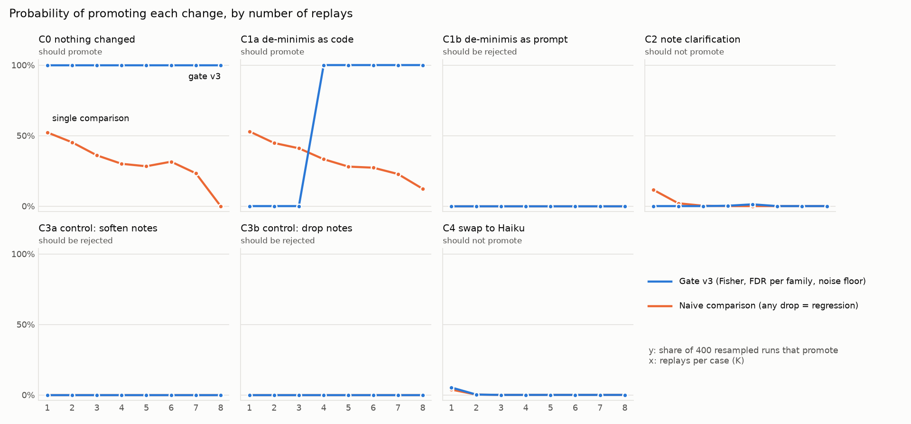
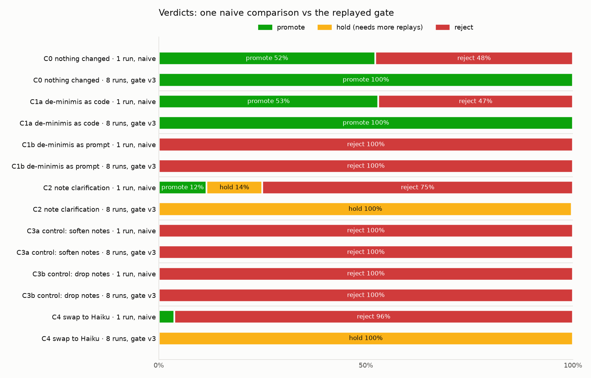
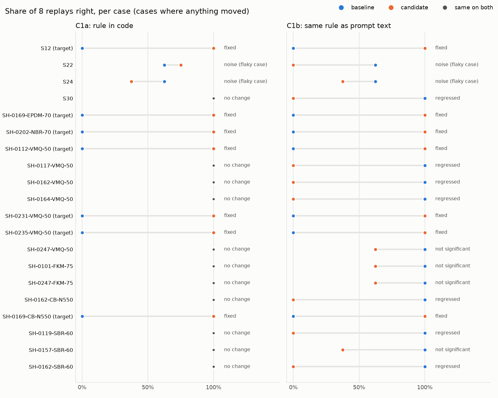

# Promotion gate: when is a change safe to promote?

Margin Guard's loop turns a miss or a reviewer override into a candidate change (a rule, a policy edit, a model swap). This report replays every candidate against 62 cases (30 hand-built scenarios + 32 judgment calls from the seeded shop), 8 times each (16 for the baseline), and decides promote / hold / reject. Everything below is computed from the cached replays by `python -m evals.promotion.report`.

## Headline

- **Two noisy cases make a single comparison a coin flip.** With nothing changed, comparing one run against another flags a regression **48%** of the time. All of it comes from 2 of the 62 cases (S22, S24) that change answer on their own. The same comparison promotes the one correct change (C1a) only 53% of the time.
- **Aggregate accuracy hides offsetting regressions.** C1b's accuracy moves -4.2% with a 95% interval of (-16.1%, +7.9%): an aggregate eval calls it a wash. Per case, it fixes 7 and breaks 7, and the gate rejects it.
- **The gate never cries wolf, and the replay count is mostly arithmetic.** Gate v3 rejects the no-op **0%** of the time at every K and promotes the correct change from **K = 4**. That number comes from the test, not the data: a clean fix (0/K → K/K) clears Fisher at α = 0.05 at K = 4 when the targets are their own family, and only at K = 6 when it is corrected against all 62 cases (gate v2: K = 6). What the data adds is that nothing else moved.
- **Blatant regressions are caught by one run; subtle ones aren't.** The three bad changes (C1b, C3a, C3b) break cases 8/8 → 0/8, so even one replay rejects them. The subtle one, C2, fixes S24 and breaks its sibling S22; one naive comparison promotes it 12% of the time.
- **In this one rule, code beat prompt.** The de-minimis rule as code (C1a) fixes all 7 targets with no regressions; as policy text (C1b) it fixes the same 7 and breaks 7 others.
- **Safe is not the same as wanted.** C1a came from one reviewer override. In 55 later reviews the reviewer never absorbed a small increase. The gate shows C1a is safe to promote, not that anyone wants it.

## Verdicts at K = 8

| Candidate | Verdict | v2 | v1 | Accuracy base → cand | Δ (95% CI) | Fixed | Regressed | Flaky |
|---|---|---|---|---|---|---|---|---|
| C0 nothing changed | **promote** | promote | promote | 98.8% → 98.6% | -0.2% (-0.6%, +0.0%) | 0 | 0 | 2 |
| C1a de-minimis as code | **promote** | promote | hold | 87.5% → 98.6% | +11.1% (+3.8%, +19.4%) | 7 | 0 | 2 |
| C1b de-minimis as prompt | **reject** | reject | reject | 87.5% → 83.3% | -4.2% (-16.1%, +7.9%) | 7 | 7 | 6 |
| C2 note clarification | **hold** | hold | hold | 98.8% → 97.8% | -1.0% (-4.0%, +1.2%) | 0 | 0 | 3 |
| C3a control: soften notes | **reject** | reject | reject | 98.8% → 89.3% | -9.5% (-17.3%, -3.2%) | 0 | 4 | 4 |
| C3b control: drop notes | **reject** | reject | reject | 98.8% → 89.7% | -9.1% (-15.9%, -3.6%) | 0 | 3 | 5 |
| C4 swap to Haiku | **hold** | hold | hold | 98.8% → 96.2% | -2.6% (-6.2%, +0.6%) | 0 | 0 | 6 |

Both sides are scored with the candidate's answer key. For C1a and C1b that key absorbs small increases, so the unchanged baseline scores 87.5% against it: that gap is what the change is for.

What triggered each candidate, and why the gate decided as it did:

- **C0 nothing changed**: Run against itself to measure the noise floor: what flips when nothing changed. *Gate:* nothing regressed.
- **C1a de-minimis as code**: Reviewer override on Q-2026-0169: absorbed a ~$30 increase that Claude sent to a call. *Gate:* nothing regressed, every target fixed.
- **C1b de-minimis as prompt**: Same override as C1a; same intent, written into the prompt instead of code. *Gate:* regressed: S30, SH-0117-VMQ-50, SH-0162-VMQ-50, SH-0164-VMQ-50, SH-0162-CB-N550, SH-0119-SBR-60, SH-0162-SBR-60.
- **C2 note clarification**: S24 (key account, $8k, 'call over $10k') wrong 3/3 runs at confidence 0.55-0.60. *Gate:* target not reliably fixed: S24; dropped >= 20% but not significant (needs more replays): SH-0162-SBR-60.
- **C3a control: soften notes**: Control: reads like a harmless wording cleanup; weakens the rule notes depend on. *Gate:* regressed: S10, S13, S14, S16.
- **C3b control: drop notes**: Control: a shorter policy; removes the override sentence entirely. *Gate:* regressed: S13, S14, S16.
- **C4 swap to Haiku**: Cost: distill onto a cheaper model if nothing regresses. *Gate:* dropped >= 20% but not significant (needs more replays): S05, S12, S19, SH-0134-FKM-75.

## The noise floor, and two changes to the gate

The baseline replayed 16 times and split in half: 60 cases right every time, 2 that change answer with nothing changed (S22, S24). Baseline accuracy 98.8% vs 98.6%; the gate's verdict on the no-op is **promote**.

Both changes below were made after seeing results, so all three versions are reported:

- **v1 → v2 (noise floor).** v1 held any change that dropped a case by 20 points without reaching significance. It held C1a over S24 (5/8 → 3/8), a case whose prompt C1a doesn't touch: pure noise. v2 requires significance on cases the noise floor already marks as flaky.
- **v2 → v3 (target family).** v2 corrected each target against all 62 cases, which is why a clean fix needed K = 6. Targets are named before any replay, so v3 corrects them as their own family. The cost: v3 promotes the subtle C2 in 1% of draws at K = 5 (v2: never).

## How many replays?

| Candidate | Should | K=1 | K=2 | K=3 | K=4 | K=5 | K=6 | K=7 | K=8 |
|---|---|---|---|---|---|---|---|---|---|
| C0 nothing changed | promote | 52% / 100% | 45% / 100% | 36% / 100% | 30% / 100% | 28% / 100% | 32% / 100% | 23% / 100% | 0% / 100% |
| C1a de-minimis as code | promote | 53% / 0% | 45% / 0% | 41% / 0% | 33% / 100% | 28% / 100% | 27% / 100% | 23% / 100% | 12% / 100% |
| C1b de-minimis as prompt | reject | 0% / 0% | 0% / 0% | 0% / 0% | 0% / 0% | 0% / 0% | 0% / 0% | 0% / 0% | 0% / 0% |
| C2 note clarification | not promote | 12% / 0% | 2% / 0% | 0% / 0% | 0% / 0% | 0% / 1% | 0% / 0% | 0% / 0% | 0% / 0% |
| C3a control: soften notes | reject | 0% / 0% | 0% / 0% | 0% / 0% | 0% / 0% | 0% / 0% | 0% / 0% | 0% / 0% | 0% / 0% |
| C3b control: drop notes | reject | 0% / 0% | 0% / 0% | 0% / 0% | 0% / 0% | 0% / 0% | 0% / 0% | 0% / 0% | 0% / 0% |
| C4 swap to Haiku | not promote | 4% / 5% | 0% / 0% | 0% / 0% | 0% / 0% | 0% / 0% | 0% / 0% | 0% / 0% | 0% / 0% |

Cells: P(promote) for the naive comparison / gate v3, over 400 resampled draws of K replays per case (without replacement, so K = 8 uses every recorded replay and has no spread). The naive rule counts any drop as a regression; past K = 1 that is a straw man (nobody calls 5/8 vs 4/8 a regression), which is why the headline uses K = 1.

Hone's *Closing the Gap #1* compares untested changes (38% fixed cleanly / 33% fixed but regressed / 29% not fixed) with replayed ones (92 / 5 / 3), and notes that replays diverge, so each change is replayed several times. This is the missing piece: how many times, and what deciding on too few costs.

## Code vs prompt (one rule)

| Case | Quote | Should | C1b did (8 replays) |
|---|---|---|---|
| S30 | standard, $9,000, $315.00 at risk | reprice | absorb 8 |
| SH-0117-VMQ-50 | standard, $27,355, $874.22 at risk | contact_customer | reprice 8 |
| SH-0162-VMQ-50 | standard, $24,470, $283.27 at risk | contact_customer | reprice 8 |
| SH-0164-VMQ-50 | standard, $41,803, $1,557.91 at risk | contact_customer | reprice 8 |
| SH-0162-CB-N550 | standard, $24,470, $310.27 at risk | contact_customer | reprice 8 |
| SH-0119-SBR-60 | standard, $61,959, $1,490.55 at risk | contact_customer | reprice 8 |
| SH-0162-SBR-60 | standard, $24,470, $617.73 at risk | contact_customer | reprice 8 |

Our reading: the prompt version says the rule applies "whatever the tier, value or contract note", and the model carried that beyond small increases, so the $15,000 call rule stopped holding on large standard quotes. The code version can't leak that way: it only fires below the line. One rule is one example, not a law.

## Live vs batch replays

The pilot ran live (3 replays per case); the rest went through the Message Batches API with the policy prompt cached. Request bodies were checked field by field against the live call (identical except the refusal fallback, which batches don't support). Baseline live vs batch: **0** cases differ significantly.

## Cost

| Candidate | Spent |
|---|---|
| C0 nothing changed | $4.88 |
| C1a de-minimis as code | $2.71 |
| C1b de-minimis as prompt | $2.73 |
| C2 note clarification | $2.93 |
| C3a control: soften notes | $3.08 |
| C3b control: drop notes | $3.07 |
| C4 swap to Haiku | $0.22 |
| **Total** | **$19.62** |

Sonnet replay: $0.0098 live, $0.0037 in a batch (61% of batch input tokens read from cache). One promote decision at K replays costs 62 × K candidate calls (baseline replays are shared across candidates): $0.23 per replay round in a batch, so $0.92 at K = 4.

## What the human reviews add

55 judgment-call cards reviewed across 3 extra shops (seeds 43, 44, 45, never the replay shop).

| Outcome | Count |
|---|---|
| approved as is | 48 |
| draft rewritten | 1 |
| action changed | 6 |
| rejected | 0 |

- A reviewer that approves everything would agree with this one **87%** of the time, so agreement alone says little; the overrides carry the signal, and there are only **6**.
- 4 of 6 overrides moved an email to a call because a contract note existed, including notes about shipping or payment terms that the policy says must not change the decision: a disagreement with the policy, not a model error.
- The same note (Harbor Point's ship-to address) produced opposite overrides on two quotes: human corrections have a noise floor too, and a loop that promotes corrections needs to measure it.
- No override absorbed a small increase, although 5 reviewed cards were under $50 at risk. The evidence that anyone wants the de-minimis rule (C1a) is a single earlier override.

Each proposed change is tracked in the [correction ledger](ledger.md) with both answers side by side: the gate's verdict (safe?) and the review evidence (wanted?). The de-minimis rule is held there as safe but not wanted, and the reviewer's own pattern ("call whenever a note exists") is logged as a proposal with 4 reviews for it and 7 against.

## What this means for a promotion loop

1. **Measure the noise floor once per baseline**, by replaying it against itself, and let every decision use it. Two flaky cases in 62 were enough to make single comparisons useless.
2. **Decide per case with false-discovery control, never on aggregate accuracy alone.** Offsetting fixes and breaks cancel in the average (C1b).
3. **Name the targets before replaying** and test them as their own family. It is the honest way to spend fewer replays on the fix you built.
4. **Hold is a real verdict.** "Not enough evidence yet" (C2, the Haiku swap) is different from "bad", and a gate that can't say it will either block good changes or wave through subtle ones.
5. **Move deterministic rules into code.** The same rule as a prompt edit leaked into unrelated cases.
6. **Treat "safe" and "wanted" as separate questions.** The gate answers the first. Reviewer corrections, which are noisy and sometimes disagree with the written policy, are evidence for the second, and need their own consistency check before they turn into policy.

## Limits

- 62 cases, one domain, one policy. The cases were built to probe this policy's edges, so the regression rates are not base rates for real changes.
- Answer keys are hand-written, and the gate measures agreement with them, not correctness: a wrong key would report a real fix as a regression. Keys are written independently of the decision code, and each candidate's key scores both sides, so a policy change is judged by what the new policy wants.
- Upstream (extraction, impact) is held fixed from the recorded trace; only the decision step is resampled. Errors upstream are not part of this noise floor.
- C2 and C4 are judgment calls in the scoring of the curve ("should not promote"): C2 swaps one fix for one break, C4 loses 2.6 points of accuracy without any single case reaching significance.
- Both gate revisions (v1 → v2 → v3) were made after seeing results; every version's verdict is reported above.
